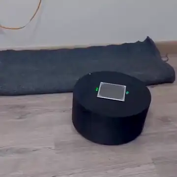
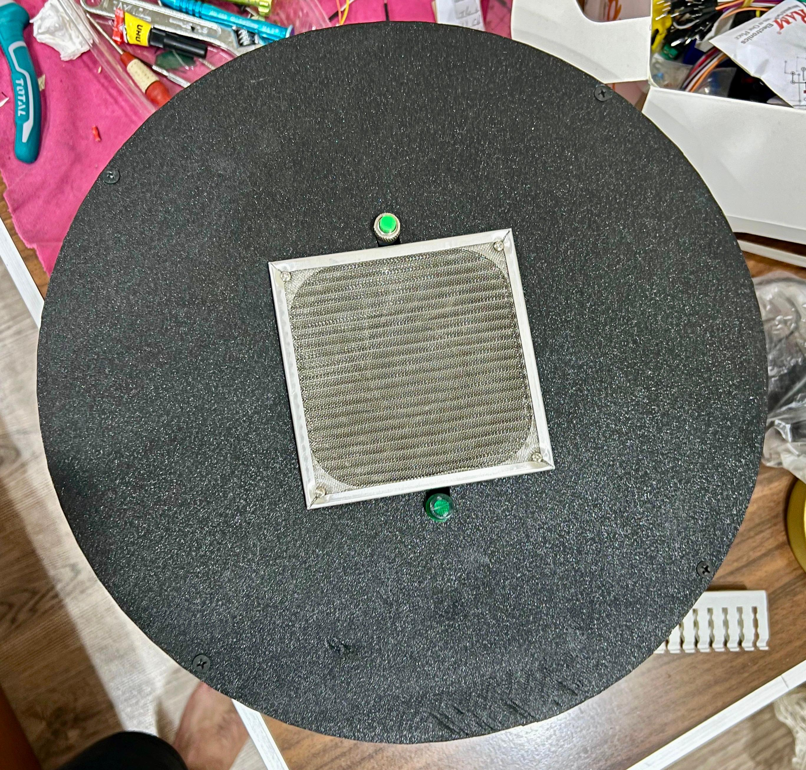
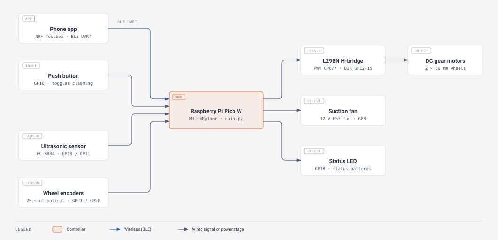
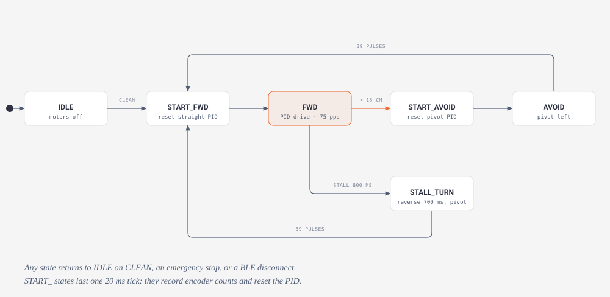
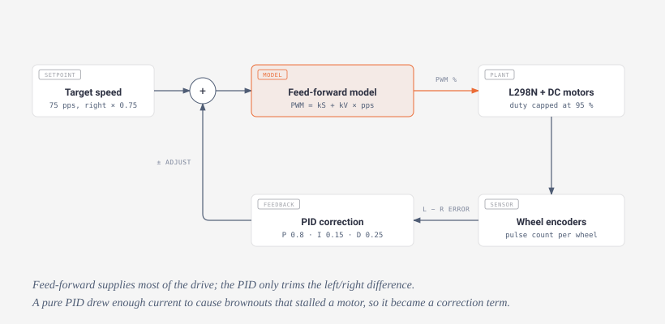

# Smart Cleaning Robot

MicroPython firmware for a low-cost floor-cleaning robot built on a Raspberry Pi Pico W, with Bluetooth Low Energy (BLE) remote control, ultrasonic obstacle avoidance, and feed-forward plus PID wheel control. It was my bachelor thesis project at the German University in Cairo (GUC), 2025.

[](https://github.com/andrew-abdelmalak/smart-cleaning-robot/actions/workflows/ci.yml)
[](LICENSE)

<p align="center">
  
  &nbsp;
  
</p>

The robot is a 35 cm round chassis that I designed in SolidWorks and 3D-printed, with a custom KiCad PCB and a repurposed PS3 fan for suction. In autonomous mode it drives straight until something is closer than 15 cm, then pivots left and carries on. From a phone you can drive it, toggle the fan, and sound a horn. The whole build cost about 80 USD (3,950 EGP).

## Results

From the prototype tests in the [thesis](docs/thesis/thesis.pdf) (Table 4.2 and section 5.1.1):

| Metric | Result |
|---|---|
| Battery runtime | More than 60 minutes of continuous autonomous operation |
| BLE range | Stable indoor connection at more than 5 m |
| Straight-line driving | PID correction noticeably reduced drift compared with open loop |
| Stall recovery | Detected a stuck wheel and recovered in simulated stuck conditions |
| Cleaning | Collected light debris (paper, dust) from hard floors |
| System power | About 26 W at 12 V (estimate from component ratings) |
| Build cost | About 80 USD, against 100 to 900 USD for the commercial robots compared |
| Size and weight | 35 cm diameter, 17 cm high, 2.65 kg |

## How it works

<picture>
  <source media="(prefers-color-scheme: dark)" srcset="docs/diagrams/architecture-dark.svg">
  
</picture>

The firmware is one file, [`firmware/main.py`](firmware/main.py), that runs a 20 ms control loop. Each pass handles, in priority order:

| Priority | Condition | Action |
|---|---|---|
| 1 | Horn on | Buzz the motors at 10 % duty as an audible horn |
| 2 | Manual command active | Drive forward, backward, or pivot |
| 3 | Autonomous mode on | Advance the cleaning state machine one step |
| 4 | Otherwise | Make sure both motors are stopped |

### Autonomous cleaning

<picture>
  <source media="(prefers-color-scheme: dark)" srcset="docs/diagrams/state-machine-dark.svg">
  
</picture>

### Motion control

A pure PID controller on the wheel encoders drew enough current to cause brownouts that stalled a motor. The final design uses a feed-forward motor model for most of the drive and keeps the PID only as a small correction to each wheel's target speed.

<picture>
  <source media="(prefers-color-scheme: dark)" srcset="docs/diagrams/control-loop-dark.svg">
  
</picture>

| Loop | Purpose | P / I / D |
|---|---|---|
| Straight | Keep both wheels at the same distance travelled | 0.8 / 0.15 / 0.25 |
| Turn progress | Reach the target pivot of 39 encoder pulses | 0.6 / 0.1 / 0.2 |
| Turn balance | Share the pivot between both wheels | 1.5 / 0.05 / 0.3 |

The feed-forward model is `PWM = kS + kV × speed`, fitted per wheel (left: kS 27, kV 0.66; right: kS 30, kV 0.61), with a right-wheel trim of 0.75 and duty capped at 95 %. All integrals are clamped to ±15.

## Hardware

| Part | Component | Pins (GP = Pico GPIO) |
|---|---|---|
| Controller | Raspberry Pi Pico W | |
| Motor driver | L298N dual H-bridge | ENA 6, ENB 7, IN1 to IN4 12 to 15 |
| Drive | 2 TT DC gear motors, 66 mm wheels | |
| Wheel encoders | 20-slot optical discs, one channel per wheel | Left 21, right 20 |
| Obstacle sensor | HC-SR04 ultrasonic | TRIG 10, ECHO 11 |
| Suction | PS3 Slim fan, 12 V, on/off through its PWM wire | 8 |
| Status LED | Green LED | 18 |
| Button | Push button to GND, internal pull-up | 16 |
| Power | 12 V Li-ion pack, LM2596S buck converter to 5 V | |
| Chassis and PCB | 3D-printed PLA+, custom KiCad PCB | |

The thesis has the full bill of materials (Appendix A), the CAD views, and the PCB schematic and layout.

## Getting started

You need a Raspberry Pi Pico W with [MicroPython for the Pico W](https://micropython.org/download/RPI_PICO_W/), [`mpremote`](https://docs.micropython.org/en/latest/reference/mpremote.html), and a phone with [nRF Toolbox](https://www.nordicsemi.com/Products/Development-tools/nrf-toolbox) or another BLE UART app.

1. Flash MicroPython: hold BOOTSEL while you connect USB, then copy the `.uf2` file to the drive that appears.
2. Copy the firmware to the board as `main.py`, so it runs at boot:

   ```bash
   mpremote cp firmware/main.py :main.py
   ```

3. Reset the board. It advertises as `PicoRobot-XXXX`, where `XXXX` comes from the board ID.
4. Connect from nRF Toolbox (UART) and send the commands below.

> [!WARNING]
> Test with the wheels off the ground first, and check the motor wiring before you enable autonomous mode. The gains and thresholds are tuned for this chassis; expect to retune `OBSTACLE_THRESHOLD_CM`, `TURN_PULSES`, and the PID gains for another build.

### Commands

Send these as text over the Nordic UART Service (writes go to RX characteristic `6E400002-B5A3-F393-E0A9-E50E24DCCA9E`). Case and surrounding spaces are ignored.

| Command | Effect |
|---|---|
| `FORWARD` | Drive straight with PID correction. Stops with the horn if an obstacle is closer than 15 cm |
| `BACKWARD`, `LEFT`, `RIGHT` | Drive backward, or pivot in place |
| Same command again | Brake and stop |
| `CLEAN` | From a full stop: toggle autonomous cleaning (fan on, state machine running). While moving: emergency stop |
| `FAN` | Toggle the suction fan (only while stopped) |
| `HORN` | Toggle the horn. Also silences the obstacle alarm |

The push button does the same as `CLEAN`. Losing the BLE connection stops the robot.

| Status LED | Meaning |
|---|---|
| Off | Idle, no phone connected |
| Slow flash | Phone connected |
| Solid | Autonomous cleaning |
| Rapid flash | Horn on or path blocked |

## Development

The tests run the real firmware on your computer against fake `machine`, `bluetooth`, and `time` modules, with a simulated clock that wraps like MicroPython's. They cover the motion math, the command handling, the safety stops, and the state machine. You need [uv](https://docs.astral.sh/uv/).

```bash
uv sync
uv run pytest
uv run ruff check .
uv run ruff format --check .
uv run mpy-cross -o main.mpy firmware/main.py
```

CI runs the same steps on every push and pull request.

```text
firmware/main.py      MicroPython firmware (copy to the board as main.py)
tests/                Host-side tests and hardware fakes
docs/diagrams/        Diagrams used in this README
docs/media/           Demo clips from the thesis presentation
docs/thesis/          Thesis PDF and its LaTeX source
```

## Known limitations

These come from the hardware and the hand tuning, and need the robot to fix and verify:

- Navigation is reactive. The robot pivots left at every obstacle; it does not map the room or follow a coverage pattern.
- The turn-balance PID adds the two wheel counts rather than comparing them, because the single-channel encoders cannot tell direction. I tuned the gains with it working that way on the prototype.
- A disconnected ultrasonic sensor reads as a clear path. A missing echo returns 999 cm.
- Pivots have no timeout. A dead encoder during a turn keeps the robot spinning.
- Braking always pulses backward, whatever the direction of travel.
- BLE has no pairing, so any phone in range can connect and drive the robot.
- Cleaning: no check valve and no brushes, so debris can spill and embedded dirt stays.

## Thesis

*Design and Implementation of a Smart Cleaning Robot*, Andrew Khalil Samuel Abdelmalak, Faculty of Engineering and Materials Sciences, German University in Cairo, June 2025.

- [Thesis PDF](docs/thesis/thesis.pdf)
- [LaTeX source](docs/thesis/main.tex), also on [Overleaf (read only)](https://www.overleaf.com/read/hzhdgbtyqgmt#95d41f)

The firmware has changed since the thesis: it now has tests, CI, and fixes for five control-logic bugs. See [CHANGELOG.md](CHANGELOG.md).

Supervised by Prof. Dr. Walid Atef Hafez Omran, co-supervised by Dr. Hisham Mostafa El Sherif, and reviewed by Dr. M. A. Moustafa Hassan.

## Contributing and security

This is a finished thesis project, so I do not plan new features. Bug reports and fixes are welcome; see [CONTRIBUTING.md](.github/CONTRIBUTING.md). Report security issues privately as described in [SECURITY.md](.github/SECURITY.md).

## License

Released under the [MIT License](LICENSE).
