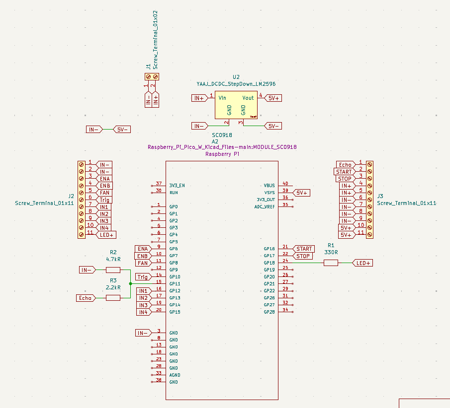
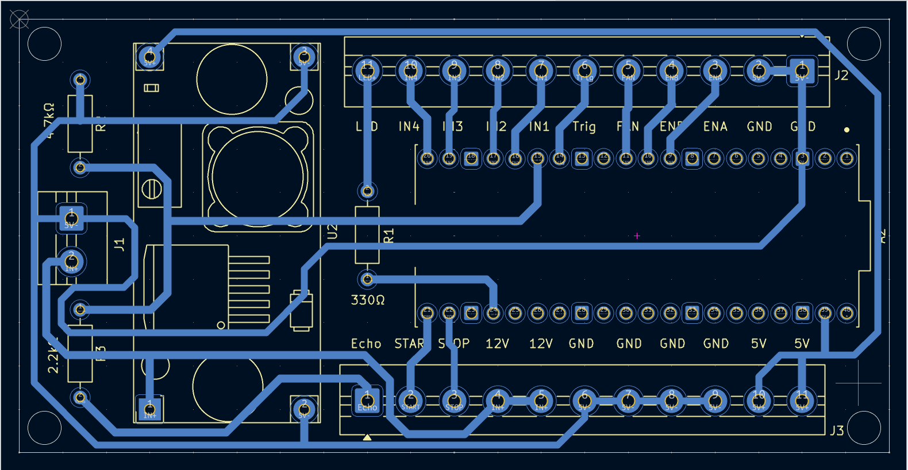
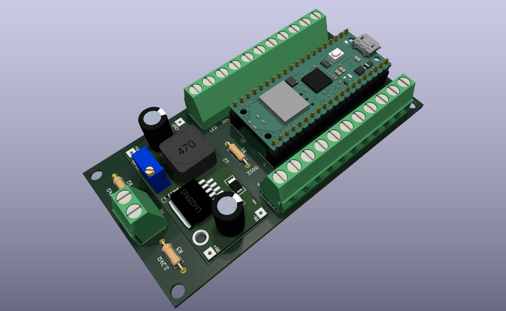
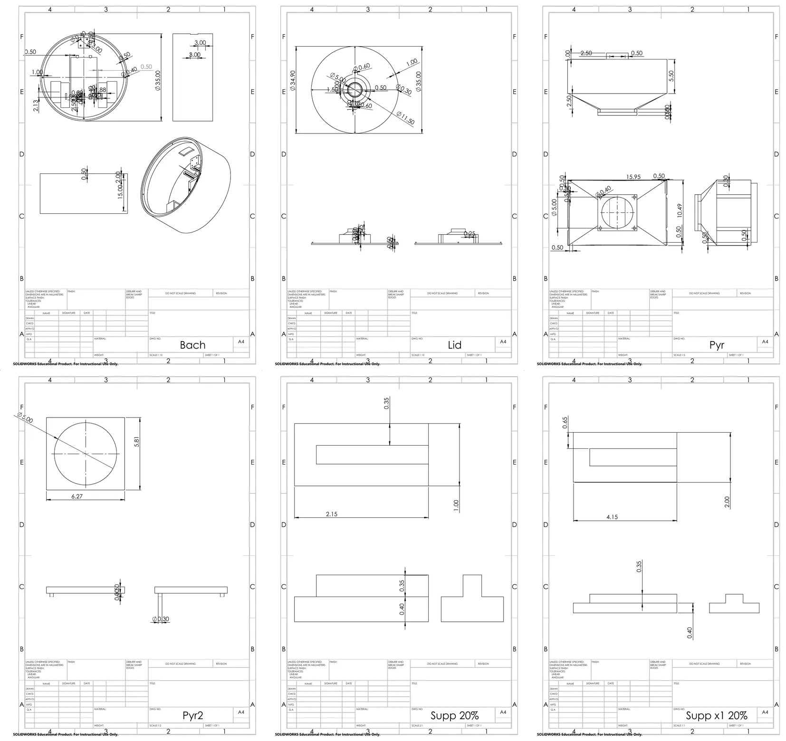
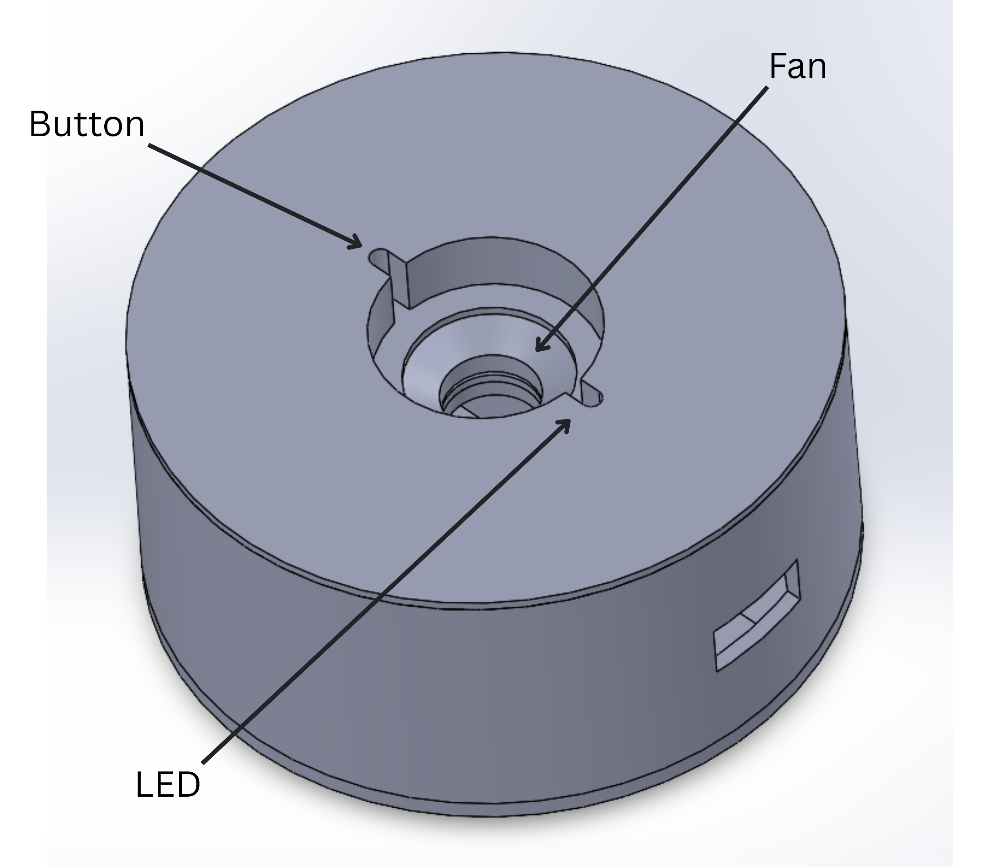
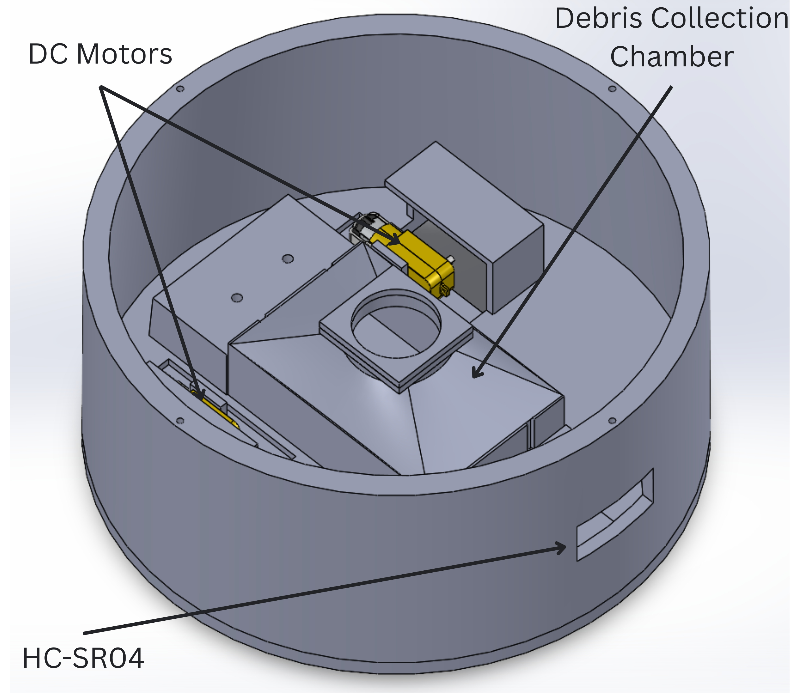

# Hardware design files

The sources I made for the robot's custom parts: the circuit board in KiCad and the 3D-printed parts in SolidWorks, with their drawings. They are released under the same [MIT License](../LICENSE) as the rest of the repository. The thesis (chapters 3 and 4) explains the design choices.

## Circuit board

[`pcb/`](pcb/) is a KiCad 9 project: open `smart-cleaning-robot.kicad_pro` in [KiCad](https://www.kicad.org/) 9 or later, which is free. It is a two-layer board, 100 × 50 mm, that carries the Raspberry Pi Pico W, an LM2596 step-down module, three resistors (2.2 kΩ, 4.7 kΩ, 330 Ω), and screw terminals for the power input, the motor driver, the ultrasonic sensor, the fan, the start and stop buttons, and the LED. It has no terminals for the wheel encoders.

| Schematic | Layout | 3D view |
|---|---|---|
|  |  |  |

The symbols and footprints, including the Pico W and the LM2596 module from third-party KiCad libraries, are embedded in the project files. The Pico W's 3D model path still points to my own computer, so KiCad's 3D viewer shows the board without that one model.

## 3D-printed parts

[`cad/`](cad/) holds the SolidWorks 2024 part files, printed in PLA+. They open in SolidWorks 2024 or later, and the free eDrawings Viewer can display them. I renamed the files to say what each part is.

| Part | File | Drawing |
|---|---|---|
| Chassis: the round shell, 35 cm across | [`chassis.SLDPRT`](cad/chassis.SLDPRT) | [`chassis.pdf`](drawings/chassis.pdf) |
| Lid | [`lid.SLDPRT`](cad/lid.SLDPRT) | [`lid.pdf`](drawings/lid.pdf) |
| Debris collection chamber | [`debris-chamber.SLDPRT`](cad/debris-chamber.SLDPRT) | [`debris-chamber.pdf`](drawings/debris-chamber.pdf) |
| Plate with a 5 cm opening, matching the chamber's port | [`chamber-plate.SLDPRT`](cad/chamber-plate.SLDPRT) | [`chamber-plate.pdf`](drawings/chamber-plate.pdf) |
| Support blocks, small and large | [`support-small.SLDPRT`](cad/support-small.SLDPRT), [`support-large.SLDPRT`](cad/support-large.SLDPRT) | [`support-small.pdf`](drawings/support-small.pdf), [`support-large.pdf`](drawings/support-large.pdf) |
| Mounts | [`mount-1.SLDPRT`](cad/mount-1.SLDPRT), [`mount-2.SLDPRT`](cad/mount-2.SLDPRT) | none |

The full assembly is not included: it uses the motor, motor driver, sensor, and wheel models I downloaded from GrabCAD, which their authors share under their own terms.

The drawings were made with the SolidWorks Education Edition, which prints its watermark on each sheet. Their dimensions are in centimetres, although the title block's default note says millimetres.

| Assembled chassis | Open chassis |
|---|---|
|  |  |
